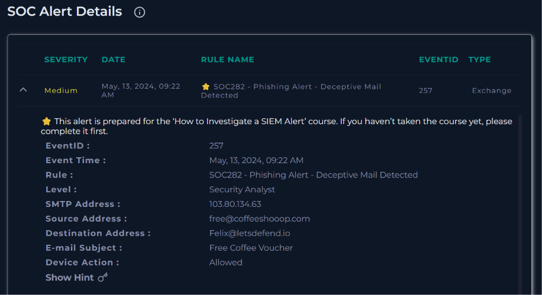
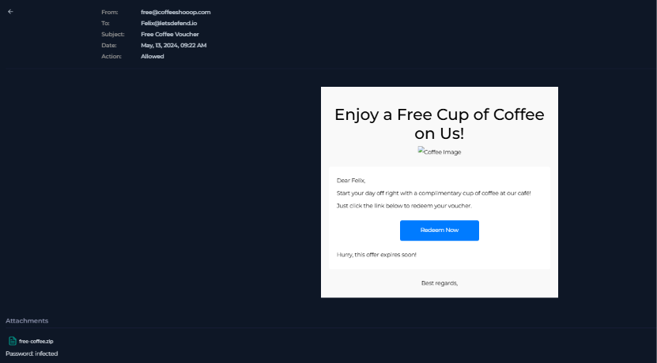
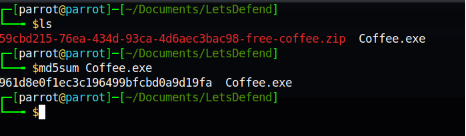
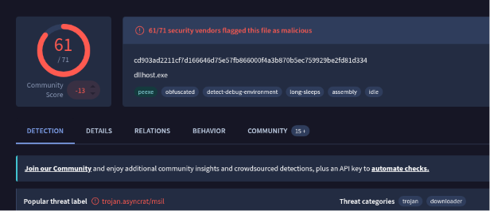
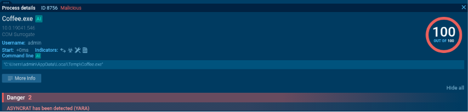
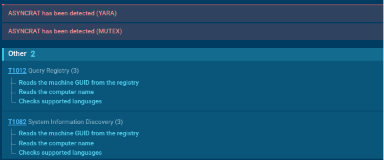
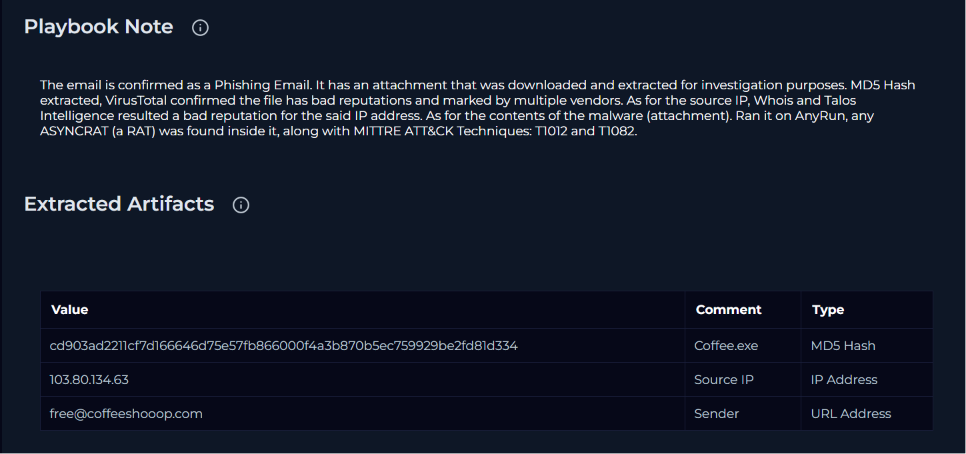

# SOC282 - Free Coffee Voucher Phishing (AsyncRAT)

Title: SOC282 - Phishing Alert - Deceptive Mail Detected

Platform: LetsDefend SOC Simulator

Link: [https://app.letsdefend.io/monitoring](https://app.letsdefend.io/monitoring)

Date: 06/14/2026

## Alert Summary

| Field | Value |
| --- | --- |
| Severity | Medium |
| Event ID | 257 |
| Rule | SOC282 - Phishing Alert - Deceptive Mail Detected |
| Type | Exchange |
| Alert Date | May 13, 2024, 09:22 AM |
| Device Action | Allowed |

## Analysis

### Phase 1: Email Triage

Starting from the SOC alert, I pulled the primary details of the email: the SMTP/source IP `103[.]80[.]134[.]63`, the sender `free@coffeeshooop[.]com`, the recipient `Felix@letsdefend.io`, and the subject line "Free Coffee Voucher."

Opening the email content showed a "Free Coffee" promotion with a "Redeem Now" button and a line reading "Hurry, this offer expires soon!" at the bottom. This is a classic urgency tactic meant to pressure the recipient into clicking without thinking. The email also carried a password-protected attachment, `free-coffee.zip`.

Before touching the attachment, I checked the artifacts I already had. The source IP `103[.]80[.]134[.]63` came back with a bad reputation on both Talos Intelligence and WHOIS. The sender domain `coffeeshooop[.]com` didn't return any hits on reputation tools, likely because it was created specifically for this lab. Combined with the urgency and the free-gift premise, though, the email already looked like a phishing lure.

### Phase 2: Attachment Analysis

To handle the attachment safely, I spun up an isolated VM, grabbed the actual download link for the zip via browser DevTools, and downloaded and extracted it inside the VM rather than on the host. The archive was password protected (password: `infected`), and extracting it revealed a single executable, `Coffee.exe`.

Running `md5sum` on the binary gave a hash of `961d8e0f1ec3c196499bfcbd0a9d19fa`. I submitted this to VirusTotal, which flagged the file as malicious with 61 of 71 vendors detecting it. VirusTotal tagged it with the popular threat label `trojan.asyncrat/msil` and categorized it as a trojan/downloader.

### Phase 3: Behavioral Analysis

To confirm what the binary actually does, I detonated it in ANY.RUN. The sandbox flagged the process with a maximum risk score of 100/100 and identified AsyncRAT, a remote access trojan (RAT), through both a YARA signature and mutex detection.

The sandbox also mapped two MITRE ATT&CK techniques tied to discovery behavior: T1012 (Query Registry), where the sample read the machine GUID and computer name and checked the supported languages in the registry, and T1082 (System Information Discovery), which covered the same set of actions from a discovery standpoint.

### Phase 4: Network Traffic Review

ANY.RUN recorded outbound connections to hosts in the United States and the Netherlands, but DNS resolutions were clean and the request/response content showed no active C2 activity. These are likely sandbox or OS telemetry noise, which is common in sandbox detonations, so I excluded them from the IOC list as unconfirmed indicators.

## Playbook & Alert Answers

| Question | Answer |
| --- | --- |
| Are there attachments or URLs in the email? | Yes |
| Check if mail delivered to user? | Delivered |
| Check if someone opened the malicious file/URL? | Opened |
| Analyze URL/Attachment | Malicious |
| Is this alert True Positive or False Positive? | True Positive |

**Alert Note:** Phishing Email Detected and Malware Analyzed.

**Playbook Note:** The email is confirmed as phishing. Its attachment was downloaded and extracted for investigation. I extracted the file's MD5 hash, and VirusTotal confirmed the file is malicious, with detections from multiple vendors. WHOIS and Talos Intelligence both returned a bad reputation for the source IP address. Running the attachment in ANY.RUN identified AsyncRAT (a remote access trojan), along with MITRE ATT&CK techniques T1012 and T1082.

## Indicators of Compromise (IOCs)

| **Indicator** | **Type** | **Description / Context** |
| --- | --- | --- |
| `103[.]80[.]134[.]63` | IPv4 | Sender SMTP IP, flagged on Talos & WHOIS |
| `free@coffeeshooop[.]com` | Email Address | Phishing sender address |
| `free-coffee.zip` | File Name | Password-protected malicious attachment (password: `infected`) |
| `Coffee.exe` | File Name | Dropped AsyncRAT payload |
| `961d8e0f1ec3c196499bfcbd0a9d19fa` | MD5 Hash | Hash of `Coffee.exe` |
| `cd903ad2211cf7d166646d75e57fb866000f4a3b870b5ec759929be2fd81d334` | SHA256 Hash | SHA256 hash of `Coffee.exe` (from VirusTotal) |
| AsyncRAT | Malware Family | Remote Access Trojan identified via YARA/mutex in ANY.RUN |
| T1012, T1082 | MITRE ATT&CK | Query Registry, System Information Discovery |
